# PT companion: Phase 0 plan

Nutrition, supplements, recovery and Garmin insights, built into Olympus.
The brief this answers lives outside the repo (`claude-code-prompt-pt-app.md`).
Decisions and their reasons are logged in [`/DECISIONS.md`](../../DECISIONS.md).

## 1. What Olympus already is (recon, 2026-11-03)

| Area | Today |
|---|---|
| Web | Next.js 15 App Router, React 18, Tailwind, PWA, at the repo root |
| DB | Neon Postgres + Drizzle (`src/lib/db/schema.ts`). Migrations are hand-written idempotent SQL in `supabase/` (the folder name is historical; there is no Supabase) |
| Auth | NextAuth v5, Google, `ALLOWED_EMAILS` allowlist. Own OAuth 2.1 server for MCP clients and the iOS app (PKCE) |
| Hosting | Vercel (`.vercel/`). No cron jobs yet; Whoop sync runs on app use and on `get_recovery` |
| iOS | **Native SwiftUI** app in `ios/`: HealthKit sync, widgets, workout Live Activity, offline outbox, `Packages/OlympusCore` (pure Swift logic, `swift test`). Uploaded to TestFlight 2026-10-14 |
| Domain | `src/domain/`: pure TS + vitest. Load maths with carriage weights, V1–V10 plan validation, double progression, sleep gate, Banister TRIMP + session-RPE load |
| Recovery data | `daily_check_ins`: sleep, sleep stages, HRV, RHR, protein, water, per-field source. Apple Health beats Whoop; a manual value beats any sync |
| Outside training | `external_activities` from Apple Health (Garmin Connect already writes there), de-duplicated against Olympus sessions |
| MCP | `/api/mcp`, 12 tools, audit log, no delete tools |

Already encoded and to be reused, not rebuilt: carriage weights, RPE progression +2.5 / +5 / reps first, the recovery gate on progression, multi-user data isolation (every table has `user_id`).

## 2. Stack decision: extend Olympus in place

**Option (a), with two changes to the brief's defaults.** Everything goes into the existing repo and database, so there is one source of truth for workouts, check-ins and the athlete profile.

1. **No Expo app. Extend the native Swift app.** A second iOS app would fork auth, offline sync and HealthKit, which already work. Widgets, lock-screen notification actions and HealthKit writes are all simpler natively.
2. **No Turborepo conversion now.** The brief wants `packages/core` so web and iOS share logic. The iOS app is Swift, so a TS package can't be shared with it anyway. `src/domain/` already plays the `packages/core` role (pure, unit-tested). New scoring code goes in `src/domain/{nutrition,recovery,supplements,insights}/`. Swift gets ports only where it has to work offline (the confirm sheet's gram maths, slot logging), in `Packages/OlympusCore`, as is done today. A workspace is still worth it if a second TS consumer appears (a separate sync worker, for example).

Otherwise the brief's defaults hold, matched to Olympus:

| Concern | Choice |
|---|---|
| Hosting | Stay on **Vercel**. Garmin sync is a route handler: a daily Vercel Cron, a refresh on app open (the existing Whoop pattern), and a manual "sync now". FIT parsing fits in a Fluid Compute function. No Render |
| DB | Same Neon DB, Drizzle, next migration `supabase/migration-011-*.sql`. Enable `pg_trgm` + `unaccent` |
| Auth | Keep Google OAuth + allowlist (already how the health data is protected). Passkeys are optional later |
| LLM | OpenRouter from the server only (`OPENROUTER_API_KEY`). Model slug is config (`app_config` row + env fallback). No Anthropic models |
| Images | Private object storage, signed URLs, 90-day expiry unless `keep_for_bench`. Candidates: Neon storage buckets (same vendor) or Cloudflare R2 (10 GB free). **Decision at Phase 4; no paid service without asking** |
| Secrets | Garmin key encrypted at rest (AES-256-GCM, key in `ENCRYPTION_KEY` env), never sent to a client |
| Time | Every new event row stores `occurred_at timestamptz` + `tz` (IANA) + `local_date`. Matches how sessions are dated today |

## 3. Data model (new tables)

All tables carry `user_id`. Existing tables are reused where they already mean the same thing.

```mermaid
erDiagram
  %% ---------- Nutrition ----------
  foods ||--o{ food_portions : "named portions (1 roti = 40 g)"
  foods ||--o{ recipe_ingredients : "recipe"
  foods ||--o{ food_log_items : ""
  food_logs ||--o{ food_log_items : ""
  photos |o--o| food_logs : ""
  saved_meals ||--o{ saved_meal_items : ""
  foods ||--o{ saved_meal_items : ""

  foods {
    uuid id PK
    text user_id "null = public DB row"
    text source "user|indb|usda_foundation|usda_sr|off|mfp"
    text source_id
    text name
    text_arr aliases "roti, chapati, phulka"
    text brand
    text barcode
    numeric kcal_100g
    numeric protein_100g
    numeric carbs_100g
    numeric fat_100g
    numeric fibre_100g
    jsonb micros_100g
    text_arr tags "coffee, soy, calcium_rich, high_fibre"
    bool verified
    tsvector search "plus trigram index on name"
  }
  food_logs {
    uuid id PK
    timestamptz eaten_at
    text tz
    date local_date
    text meal_slot
    text input_mode "photo|text|search|barcode|saved|supplement|mfp_import"
    text raw_text
    text model
    numeric cost_usd
  }
  food_log_items {
    uuid id PK
    uuid food_id FK
    numeric grams
    numeric est_grams "model's guess, kept for portion memory"
    numeric confidence
    numeric kcal "snapshot at log time"
    numeric protein_g
    numeric carbs_g
    numeric fat_g
    numeric fibre_g
    bool counts_to_protein "false for collagen by default"
    uuid supplement_log_id
  }
  photos {
    uuid id PK
    text storage_key
    timestamptz expires_at
    bool keep_for_bench
  }

  %% ---------- Supplements & labs ----------
  supplements ||--o{ supplement_ingredients : ""
  supplements ||--o{ supplement_logs : ""
  supplements ||--o{ inventory_events : ""
  supplements }o--o| foods : "whey/collagen nutrition"
  supplements ||--o{ supplement_markers : "D3 -> 25-OH D"
  timing_rules }o--o{ supplements : "by tag"
  lab_results }o--|| supplement_markers : "by marker"

  supplements {
    uuid id PK
    text name
    text brand
    text form
    text serving_desc
    int servings_per_container
    text slot "waking|with_meal|pre|post|bedtime"
    int_arr active_days
    text_arr tags "levothyroxine, calcium, iron, biotin, magnesium"
    jsonb where_to_buy "UAE vs India"
  }
  supplement_logs {
    timestamptz taken_at
    text tz
    text status "taken|skipped|half|late"
    numeric dose_multiplier
  }
  timing_rules {
    text subject_tag
    text object_tag
    int min_gap_min
    text applies "before|after|either"
    text message
    text citation
    bool enabled
  }
  lab_results {
    date drawn_on
    text marker "TSH, FT4, 25OHD, ferritin, Mg"
    numeric value
    text unit
  }
  lab_appointments {
    timestamptz scheduled_at
    jsonb checklist
  }

  %% ---------- Garmin & recovery ----------
  raw_garmin {
    bigint id PK
    text endpoint
    date range_start
    date range_end
    text summary_id
    jsonb payload
    text payload_hash
    timestamptz fetched_at
  }
  daily_wearable {
    date date PK
    text source PK "garmin|apple_health|whoop"
    int hrv_overnight_ms
    text hrv_method "rmssd|sdnn"
    int rhr
    int sleep_min
    jsonb sleep_stages
    timestamptz sleep_start
    timestamptz sleep_end
    numeric respiration
    numeric spo2
    numeric skin_temp_dev
    int stress_avg
    jsonb body_battery
  }
  activity_streams {
    text activity_external_id PK
    jsonb laps
    bytea hr_series "1 Hz, compressed"
    jsonb strength_sets
  }
  daily_scores {
    date date PK
    int recovery
    jsonb recovery_parts
    numeric strain
    numeric strain_target_lo
    numeric strain_target_hi
    int sleep_need_min
    int sleep_debt_min
    text formula_version
    bool calibrating
  }
  journal_questions ||--o{ journal_answers : ""
  journal_questions { text key PK
    text label
    bool active }
  journal_answers { date date PK
    text key PK
    bool value }
  body_comp {
    timestamptz measured_at
    text method "BIA|DEXA"
    text device
    numeric weight_kg
    numeric fat_mass_kg
    numeric vfa_cm2
    bool morning
    bool fasted
    bool pre_training
    bool same_machine
    bool valid "generated from the four flags"
  }
  weigh_ins { timestamptz measured_at
    numeric kg
    text source }

  %% ---------- Bench ----------
  bench_items ||--o{ bench_predictions : ""
  bench_items { text dataset "nutrition5k|mine"
    jsonb truth }
  bench_predictions { text model
    text pipeline
    text prompt_variant
    int image_px
    jsonb output
    int latency_ms
    numeric cost_usd }
```

How the new tables connect to the existing ones:

- **Workouts:** none of the new tables store workouts. Garmin activities go into the existing `external_activities` table (`source = 'garmin'`). They are matched to Olympus sessions with the existing overlap logic: Garmin wins on time and HR, Olympus on sets, reps and load. `activity_streams` holds the FIT detail for a row.
- **Check-ins:** `daily_wearable` stores one row per device per night. `daily_check_ins` stays the merged view Claude already reads, with Garmin added to the source order. A manual value still beats any sync.
- **Protein:** the food log becomes the source for `daily_check_ins.protein_g` (new source `food_log`). This retires the MyFitnessPal → Health → Shortcut bridge.
- **Targets:** kcal and protein stay in `athlete_profiles`. New profile fields: `zone2_lo/hi` (130/140), `collagen_counts_to_protein` (false), `sleep_need_base_min`, `tdee_mode`.

## 4. Phase plan

The estimates count focused build sessions with me. Calendar time depends on your data and reviews.

| Phase | Builds | Est. | Blocked on you |
|---|---|---|---|
| **1 Garmin discovery + sync** | Check the API against the live Swagger. Key storage (encrypted) + token exchange + 14-day expiry reminder. Discovery script: every documented endpoint, last 30 days, saved to `raw_garmin`, field-coverage report for the Instinct 2 + Cirqa. Then the incremental sync + FIT parse | 2 | Personal API key from Garmin Connect |
| **2 Food DB + manual/text logging** | Import INDB (GitHub), USDA Foundation + SR Legacy, Open Food Facts for the IN and AE countries (plus live barcode lookup with a cache). Search (FTS + trigram, your foods first). Recipes from weighed ingredients, saved meals, recents, favourites. MFP CSV import. Text parser (LLM gives items + grams, DB gives nutrients). Daily view with protein first. Web first, then iOS screens | 4 web + 2 iOS | MFP CSV export |
| **2b Supplements** | Stack, slot logging, rules engine + cited rule seeds, whey/collagen into the food log, inventory, labs + markers, pre-lab checklist. iOS lock-screen action ("Morning stack taken") | 3 | Confirm doses (§6) |
| **3 Vision bench** | `bench/` harness, Nutrition5k sample, capture flow for your weighed meals, report + chart | 2 + ~2 weeks of meal capture | ~40 weighed meals |
| **4 Photo logging** | Chosen model, downscaling, confirm/edit sheet (web + iOS camera-first), portion memory from your corrections, reference-object hint | 2–3 | Storage choice |
| **5 Recovery layer** | Recovery, strain + target, sleep need/debt, journal + impact analysis, backfilled from Garmin history. `docs/metrics.md` | 3 | |
| **6 Insights + extras** | Adaptive TDEE, body comp, thyroid-aware nudges on food, labs view, weekly report, morning brief (push), pre-gym view, protein distribution, travel mode | 4–5 | |
| **7 MCP** | `get_nutrition`, `get_daily_summary`, `get_recovery_trend`, `get_journal_impacts`, `get_body_comp`, `get_weekly_report`, `get_supplement_adherence`, `get_labs` | 1 | |

From Phase 2 on, every scoring module ships with vitest tests, and a `scripts/seed-companion.ts` script fills a local DB with 60 days of realistic data.

**Order tweak:** if the Garmin key isn't ready, I'll start Phase 2 (food) and come back. Food logging is the part you'll use every day, and it doesn't depend on Garmin.

## 5. Where I'm pushing back

1. **Expo and the monorepo.** Covered in §2.
2. **The energy bank goes last.** Garmin Body Battery already does most of what it would. I'll build it only if recovery + strain + Body Battery side by side leave a gap.
3. **HRV baselines are per device.** Apple Health HRV is SDNN, while Whoop and Garmin overnight HRV are RMSSD-based. They aren't comparable, so baselines are keyed by `(source, method)`. Moving to Garmin means about 14 days of "calibrating" no matter how much older data exists. Whoop history stays visible but never feeds the Garmin baseline.
4. **The bench grid is too big.** 200 images × 5 models × 2 pipelines × 3 prompts × 2 sizes is about 12k calls. Plan: run the full grid on a 40-image subset, then only the top 2 configs on all 200 plus your meals. That keeps total spend to a few dollars. Nutrition5k is also huge (~180 GB), so I'll fetch only the overhead RGB images of the sampled dishes.
5. **Garmin API caveats.** Only one third-party write-up confirms the personal tier so far. It says FIT files delivered through the API may have undocumented fields stripped (VO2 max, recovery time). It also lists `PERSONAL_API_NUTRITION_READ` among the scopes. The discovery report will settle what's actually there before any feature depends on it.
6. **Vercel cron limits.** The Hobby plan only allows daily crons. Daily cron + sync on app open + manual sync is enough for one user. If you're on Pro, I'll sync hourly.

## 6. Supplement stack (confirmed 2026-11-03)

| Item | Dose | Slot | Open point |
|---|---|---|---|
| Thyronorm | 150 mcg | On waking | Coffee comes 3–4 h later, so the 30–60 min rule is met by a wide margin |
| Selenium | **100 mcg** (not 200) | With a meal | |
| Magnesium glycinate | 2 tablets, 200 mg of glycinate total (about 28 mg elemental, since glycinate is ~14% magnesium) | Bedtime | Stored as compound + elemental so labs and adherence read correctly |
| Vitamin D3 | **60,000 IU once a week, Saturday** | With a fat-containing meal | |
| Naturelo One Daily | 1 tab | With a meal, ≥4 h after Thyronorm | Label photo later (iron, calcium, biotin) |
| ON Gold Standard Whey | 1 scoop, 24 g protein (~31 g powder) | Post-workout | Confirmed |
| Sports Research Multi Collagen | 1 serving | Flexible | Nutrition from the label |
| Creatine monohydrate | **5 g** daily | Any time | Confirmed |

## 7. Garmin Personal API (verified 2026-11-03)

- Key: Garmin Connect web › Settings › Personal API token. Expires after 30, 90, 180 or 365 days. Garmin emails a week before expiry; we remind at 14 days.
- Token: `POST https://personal.connectapi.garmin.com/personalapitoken-service/personal-api/personal-api-key/token`, header `Authorization: ApiKey <key>`. Access tokens last 24 h. There are no refresh tokens, so the key is exchanged again each time.
- 26 documented GET endpoints (OpenAPI 3.0.1, extracted from the Swagger page bundle). The catalogue is in `src/server/integrations/garmin/endpoints.ts`. They include overnight HRV (`/hrv-service/hrv/daily/{from}/{to}`), sleep with Garmin's own sleep need, stress, Body Battery, daily summaries v2 (respiration, pulse ox, jet lag), weight, the activity list and the FIT ZIP download.
- No documented rate limit. The client spaces calls 500 ms apart and backs off on 429 and 5xx.
- Vercel Hobby: one cron per day. Sync runs from that daily cron, on app open (when the data is older than 30 min) and from "Sync now".
